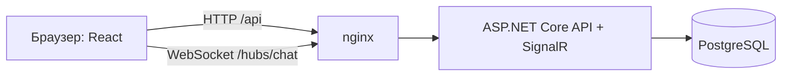

# Djama


**Djama** — веб-мессенджер для общения сообществ (семья, друзья, землячества, ассоциации). Название происходит от слова «jama / djama» — «сообщество, община».

Клиент-серверное приложение: ASP.NET Core + Entity Framework Core + SignalR + PostgreSQL (backend), React + Vite (frontend), Docker + Nginx + GitHub Actions (инфраструктура).

## Репозитории
| Репозиторий | Содержимое |
|---|---|
| `djama-backend` | API, SignalR-хаб, база данных, тесты, `docker-compose.yml` |
| `djama-frontend` | React-приложение, Dockerfile и nginx (отдаёт сайт и проксирует `/api`, `/hubs`) |
| `djama-docs` | эта документация: контракты API, ERD, сценарии, задачи команды |

## Архитектура


## Запуск (3 команды)
```bash
# три репозитория лежат рядом: djama-backend, djama-frontend, djama-docs
cd djama-backend
cp .env.example .env
docker compose up --build        # сайт: http://localhost   |   Swagger: http://localhost/swagger
```
Разработка без Docker: `docker compose up db -d`, затем `dotnet run --project src/Djama.Api` (порт 8080) и `cd ../djama-frontend && npm install && npm run dev` (порт 5173).

## Документы
- [`api-contracts.md`](api-contracts.md) — единый контракт: эндпоинты, DTO, события SignalR, коды ошибок, переменные
- [`erd.md`](erd.md) — схема базы данных (10 таблиц)
- [`use-cases.md`](use-cases.md) — сценарии использования
- [`team-tasks.ru.md`](team-tasks.ru.md) — что делает каждый участник дальше
